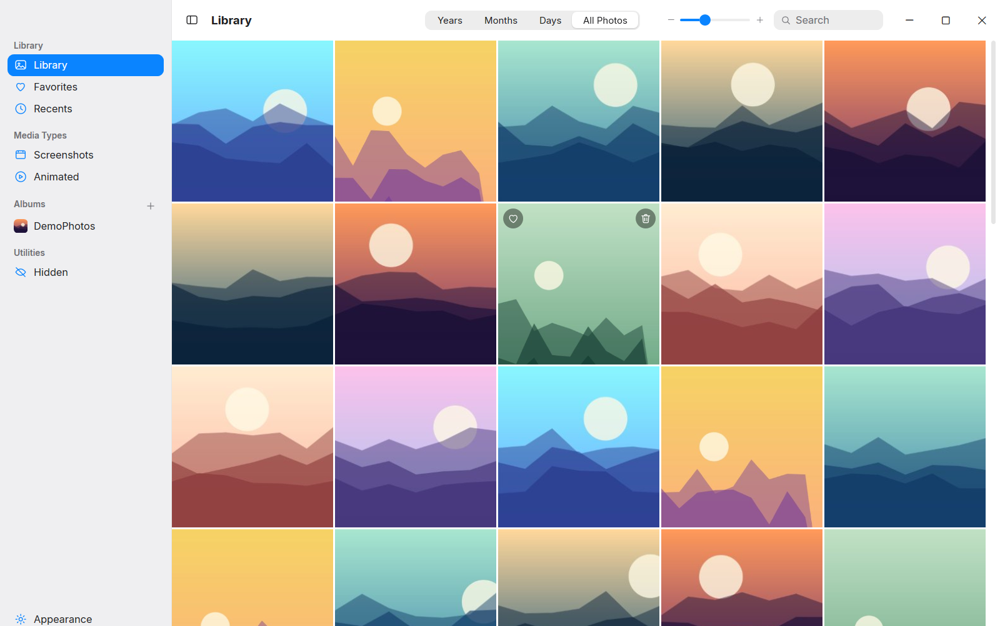
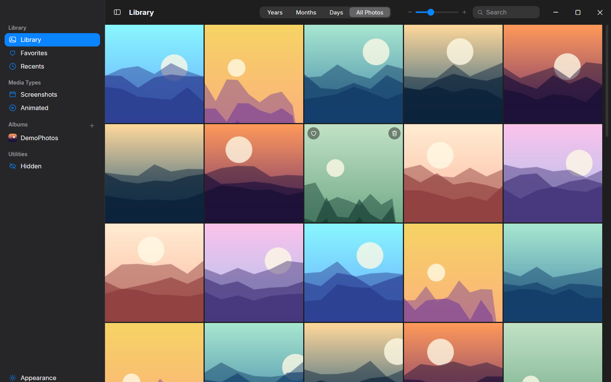
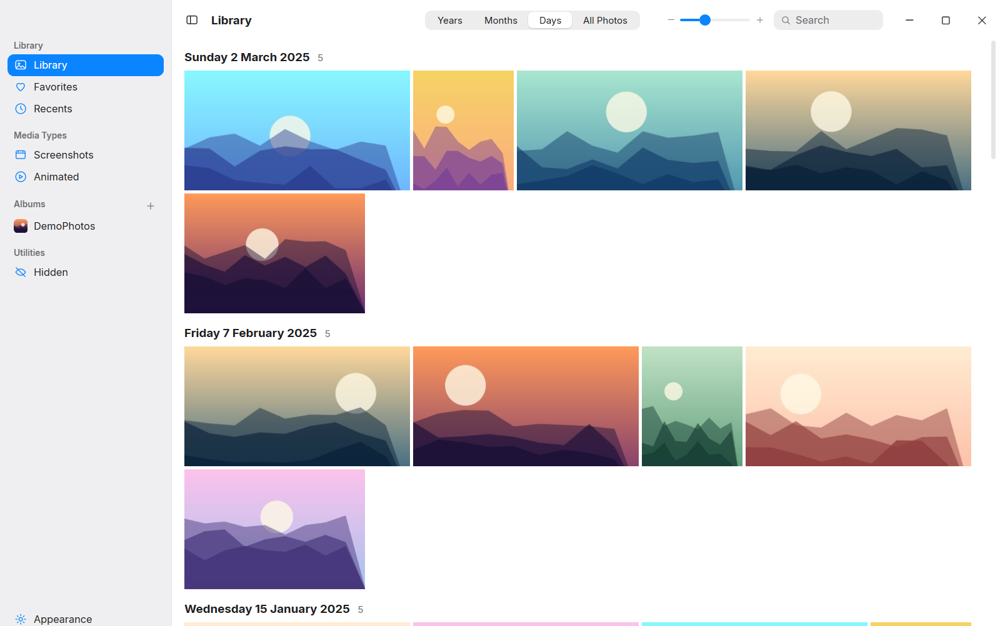
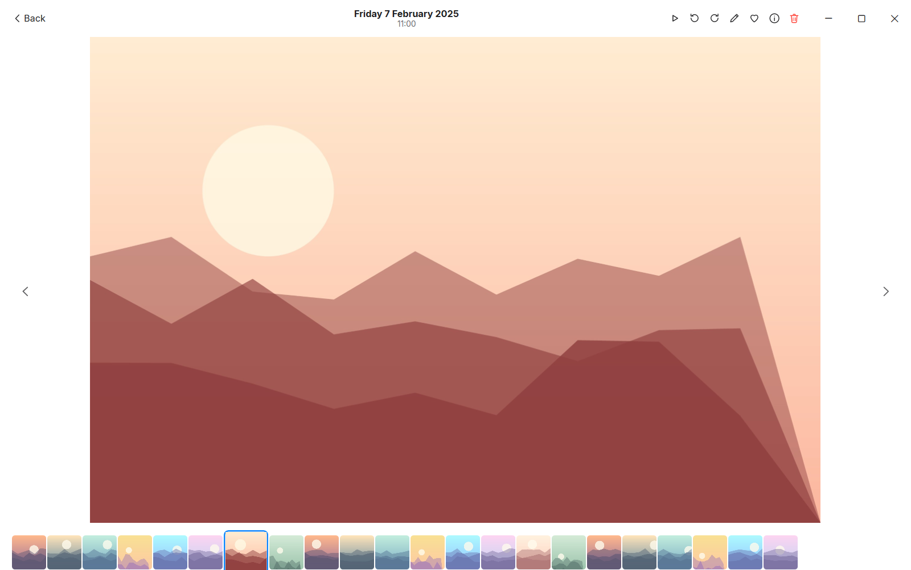
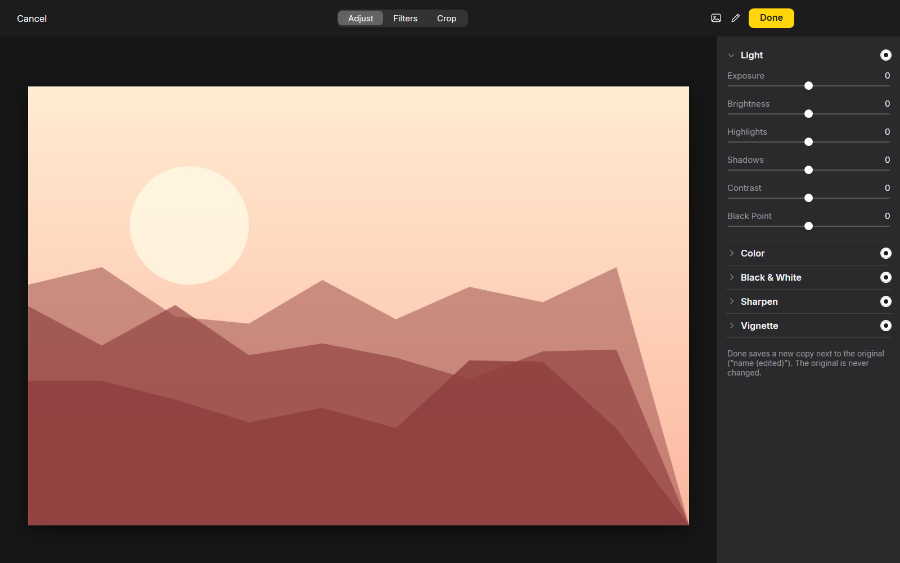

# Gallery for Windows

A fast, modern, native photo gallery and viewer for Windows 10/11, built with **WPF on .NET 8**. Think of the Apple Photos look and feel, but local, light on RAM, and it never uploads or modifies your pictures.



## Features

- **Library views:** Years, Months, Days and All Photos, plus Favorites, Recents, Screenshots, Animated, Albums (one per library folder) and Hidden.
- **Lightbox:** arrow-key navigation, filmstrip, zoom, slideshow, photo info, Show in Explorer.
- **Rotate** photos (`R` / `Shift+R`). Rotation is remembered and the original file is untouched.
- **Built-in editor:** Adjust (exposure, brightness, highlights, shadows, contrast, black point, colour, black & white, sharpen, vignette), Filters and Crop. Saving creates a copy named `name (edited)`; the original is never changed.
- **Safe delete:** `Delete` moves photos to the Recycle Bin, `Shift+Delete` deletes permanently (with a confirmation). Works on multi-selection.
- Light, Dark and Auto (follows Windows) themes, thumbnail size slider and search (`Ctrl+F`).
- Opens JPG, PNG, GIF, WebP, BMP, ICO, AVIF, SVG, and HEIC/HEIF and TIFF via the Windows imaging codecs.
- Registers as an **Open with** handler for common image types on Windows 11.
- Low memory use: software rendering, an on-disk thumbnail cache and no browser runtime.
- Single instance: opening another image reuses the running window.

| Dark theme | Days view |
| --- | --- |
|  |  |
| **Lightbox** | **Editor** |
|  |  |

*Screenshots use generated demo images, not real photos.*

## Keyboard shortcuts

| Key | Action |
| --- | --- |
| `←` / `→` | Previous / next photo |
| `F` | Toggle favourite |
| `R` / `Shift+R` | Rotate clockwise / counter-clockwise |
| `E` | Open editor |
| `I` | Photo info |
| `+` / `-` / `0` | Zoom in / out / reset |
| `Delete` | Move to Recycle Bin |
| `Shift+Delete` | Delete permanently (asks first) |
| `Ctrl+A` | Select all |
| `Ctrl+F` | Search |
| `Esc` | Close lightbox / clear selection |

## Installation

1. Download `Gallery-Setup-2.0.0.exe` from the [latest release](../../releases/latest).
2. Run it and accept the administrator prompt (it installs to `C:\Program Files\Gallery` and registers file associations machine-wide).
3. Start **Gallery** from the Start Menu or Desktop. On first launch use **+** next to *Albums* to add a folder; subfolders are scanned too.

Windows may show a SmartScreen warning because the installer is not code-signed: choose **More info -> Run anyway**.

If an older Electron build of Gallery is installed, the installer removes it first.

## Uninstallation

Use **Settings -> Apps -> Installed apps -> Gallery -> Uninstall**, or run `C:\Program Files\Gallery\Uninstall.exe`. This removes the app, shortcuts and registry entries.

Your settings and thumbnail cache are left behind; delete them for a clean slate:

- `%APPDATA%\GalleryWpf`
- `%LOCALAPPDATA%\GalleryWpf`

## Build from source

Requirements: Windows, [.NET 8 SDK](https://dotnet.microsoft.com/download/dotnet/8.0). [NSIS](https://nsis.sourceforge.io/) is only needed to build the installer.

```powershell
cd wpf

# run a debug build
dotnet run -c Release

# self-contained single-file exe (wpf\publish-sc\Gallery.exe)
dotnet publish -c Release -r win-x64 --self-contained -p:PublishSingleFile=true -o publish-sc

# installer (wpf\dist\Gallery-Setup-2.0.0.exe)
makensis installer\gallery.nsi
```

Close any running `Gallery.exe` before building (the exe is locked while it runs).

Optional environment variables for development: `GALLERY_DATA` (use a separate settings folder) and `GALLERY_HW=1` (enable hardware rendering).

## Repository layout

| Path | Contents |
| --- | --- |
| `wpf/` | Current app (WPF, .NET 8) and NSIS installer script |
| `legacy-electron/` | The original Electron version (1.x), kept for reference |
| `docs/screenshots/` | README screenshots |

See [CHANGELOG.md](CHANGELOG.md) for history, from the Electron v1 to the WPF 2.0.0 rewrite.

## Privacy

Gallery works entirely offline. It never uploads, and only writes to your photo folders when you explicitly save an edited copy or delete a photo.

## License

[MIT](LICENSE). The Inter font is under the SIL Open Font License; see [THIRD_PARTY_NOTICES.md](THIRD_PARTY_NOTICES.md).
